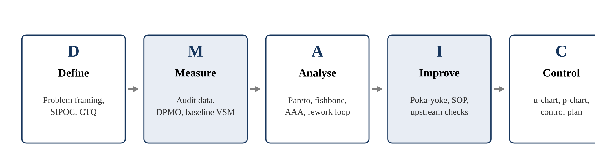
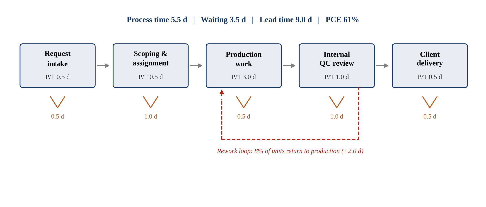
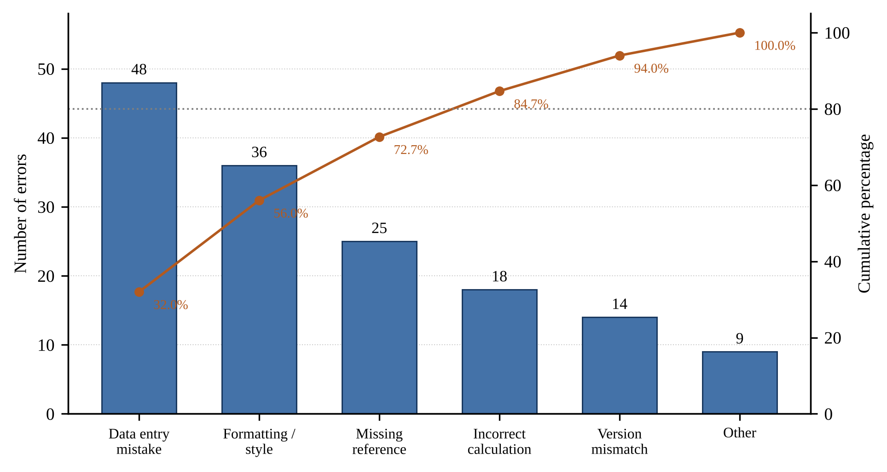
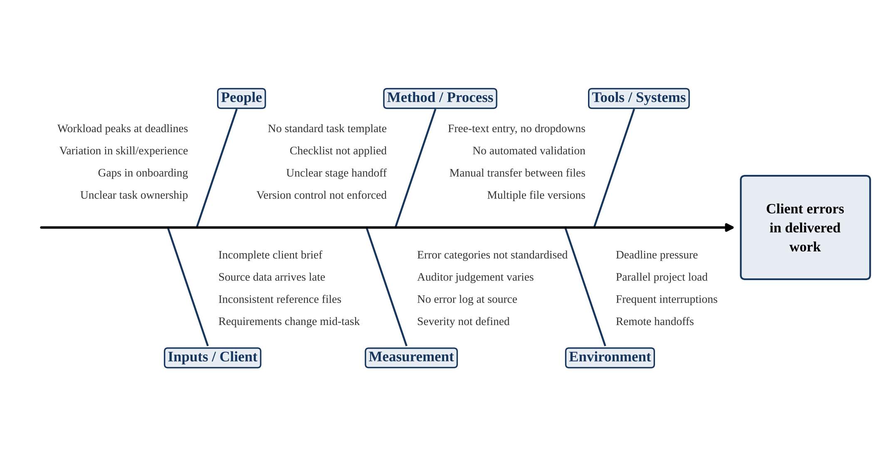

# Lean Six Sigma — DMAIC Applied to Service Delivery

An academic Lean Six Sigma project applying the **DMAIC** framework to reduce client-facing
errors and delivery delay in a professional services setting, with a second case study applying
the same framework to restaurant service time.

**Author** — S Rohit (23MIA1175)
Integrated M.Tech Business Analytics, Vellore Institute of Technology, Chennai

Completed as a team project. Co-authors' names and registration numbers are omitted from this
public copy; full attribution appears in the version submitted to the department.

---

## Case Study A — SKARR Business Solutions (primary)

A Chennai-based consulting firm working in digital publishing, data analytics and web
development. The project targets **client errors in delivered work units** and the rework loop
those errors create.

### Baseline

| Metric | Value |
|---|---|
| Work units audited | 1,200 |
| Units containing at least one error | 96 |
| Total errors recorded | 150 |
| Percentage defective | 8.00 % |
| First time yield | 92.00 % |
| Defects per unit (DPU) | 0.125 |
| Errors per defective unit | 1.56 |
| DPMO | 12,500 |
| Process sigma (short term) | ≈ 3.74 σ |
| Lead time, first-time-right unit | 9.0 days |
| Lead time with rework | 11.0 days |
| Process cycle efficiency | 61 % |

### Key findings

- **The data is attribute data**, not variable data. Units are classified pass/fail and errors are
  counted, so the analysis uses the p / np / c / u chart family — not X-bar/R, t-tests or Gage R&R.
- **Errors are clustered, not random.** At 1.56 errors per defective unit, failure concentrates in
  particular units, pointing to structural causes rather than individual inattention.
- **Three error categories cause 72.7 % of all errors** — data entry mistakes, formatting
  deviations and missing references. All three are amenable to error-proofing.
- **The measurement system is the binding constraint.** Error categories are not standardised,
  severity is undefined and no error log is captured at source, so the baseline's precision is
  unverified. Attribute agreement analysis (Cohen's kappa) must precede any improvement claim.
- **Quality and speed are the same problem.** The rework loop converts every error into additional
  lead time: 8 % of units return to production at +2.0 days each, consuming 16 days of capacity
  per 100 delivered units.

### Projected outcome

Assuming a 50 % reduction in the three dominant Pareto categories:

| Metric | Baseline | Projected | Change |
|---|---|---|---|
| Total errors per 1,200 units | 150 | 95.5 | −36.3 % |
| Percentage defective | 8.00 % | 5.09 % | −2.91 pts |
| DPMO | 12,500 | 7,958 | −36.3 % |
| Process sigma | 3.74 σ | 3.91 σ | +0.17 σ |
| Rework days per 100 units | 16.0 | 10.2 | −36.3 % |

> These are analytically derived projections, not post-implementation measurements.

---

## Case Study B — NK Grand Park Restaurant

The same DMAIC framework applied to guest waiting time, from arrival to food served, supported by
a discrete-event simulation.

| Scenario | Arrival → served | Parties over 20 min | Wait for table |
|---|---|---|---|
| S0 Baseline (2 / 4 / 2 staff) | 21.6 ± 1.8 min | 46.6 % | 3.1 min |
| S1 Move one order taker to kitchen | 18.6 ± 1.0 min | 33.8 % | 1.9 min |
| S2 Kitchen 15 % faster | 16.8 ± 1.0 min | 25.1 % | 1.5 min |
| **S3 Both combined** | **16.1 ± 0.7 min** | **20.7 %** | **1.2 min** |

The kitchen is the constraint at 66 % utilisation while order taking sits idle at 19 %. Waiting for
a table and the kitchen queue together account for 98 % of all non-value-adding time.

---

## Figures

| | |
|---|---|
|  | **Figure 1** — DMAIC analytical framework |
|  | **Figure 2** — Current-state value stream map with rework loop |
|  | **Figure 3** — Pareto distribution of error categories |
|  | **Figure 4** — Root-cause fishbone analysis |

---

## Repository structure

```
docs/            Journal-format manuscript (.docx and .pdf)
presentations/   Project decks — literature survey, attribute-data analysis, restaurant case
figures/         Publication-quality figures at 300 dpi
data/            Audit summary, Pareto distribution, value stream and simulation results (CSV)
src/figures/     matplotlib figure generation
src/manuscript/  docx-js manuscript generator
src/decks/       pptxgenjs deck generators
```

## Reproducing the outputs

```bash
# Figures
pip install matplotlib
python src/figures/figs.py

# Manuscript (expects the figures in the working directory)
npm install docx
node src/manuscript/build.js

# Decks
npm install pptxgenjs react-icons react react-dom sharp
node src/decks/gen_icons_skarr.js && node src/decks/skarr_dataset_deck.js
```

## Methods and tools

DMAIC · SIPOC · Voice of Customer → CTQ · DPMO and process sigma · Pareto analysis ·
Fishbone (cause-and-effect) analysis · Value Stream Mapping · Attribute Agreement Analysis
(Cohen's kappa) · Poka-yoke · u-chart and p-chart statistical process control ·
Discrete-event simulation

## Licence

The source code in `src/` is released under the [MIT Licence](LICENSE).

The documents in `docs/` and `presentations/` are academic coursework, shared here for reference
and review. They are co-authored work; please cite rather than reuse them wholesale.
